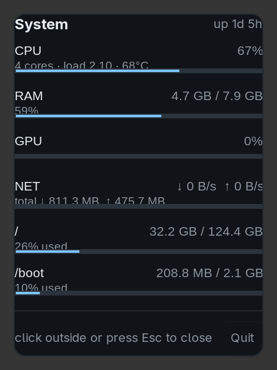

# sysmon

A small tray system monitor for [Omarchy](https://omarchy.org) / Hyprland.

The tray icon is two stacked bars — CPU on top, RAM below. Click it for a
compact panel with CPU, RAM, GPU, network and disk. Nothing is read until you
open the panel, and the refresh timer only exists while the panel is visible.



## Why it exists

Most tray monitors poll continuously, whether you are looking at them or not.
This one does not:

| | CPU cost |
|---|---|
| Panel closed | **~0.04% of one core** |
| Panel open (1.5 s refresh) | **~0.19% of one core** |
| Memory | ~27 MB |

With the panel closed, the only work is a single tick that reads two small
files, `/proc/stat` and `/proc/meminfo`. Disk, network, sensors and GPU are read
**only** while the panel is visible, and that timer is torn down on close. No
psutil, no subprocesses in the idle path.

## Requirements

- Python 3 with PyGObject (`Gtk 3.0`, `AyatanaAppIndicator3` — provided by
  `python3-gobject` / `libayatana-appindicator3` on Arch)
- Omarchy or any Hyprland desktop running a `StatusNotifierItem` tray host
- Optional, for Intel GPU numbers: `kernel.perf_event_paranoid=0`

## Install

```sh
git clone https://github.com/Apelsinic29/sysmon.git ~/DEVELOPMENT/sysmon
cd ~/DEVELOPMENT/sysmon

mkdir -p ~/.config/systemd/user
cp sysmon.service ~/.config/systemd/user/
systemctl --user daemon-reload
systemctl --user enable --now sysmon.service
```

Then pin it to the bar so it is not hidden behind the tray drawer. In
`~/.config/omarchy/shell.json`, add `"sysmon"` to the `pinned` array of the
`omarchy.tray` entry in `bar.layout.right`, then reload the shell:

```sh
kill -SIGUSR1 $(pgrep -x quickshell)
```

Autostart uses a systemd **user** unit on purpose — Omarchy ignores
`~/.config/autostart/*.desktop` because its entries are `Hidden=true` stubs.

## GPU support

The GPU row adapts to the hardware, and says why when it cannot read anything:

| Hardware | Source |
|---|---|
| amdgpu, newer i915/xe | `/sys/class/drm/card*/device/gpu_busy_percent` |
| Intel iGPU (older i915) | perf PMU engine counters (`rcs0`/`bcs0`/`vcs0`/`vecs0`) |
| NVIDIA | `nvidia-smi` |

The reported figure is the **busiest single engine**, not their sum, because
summing engines can exceed 100% and reads as a broken number.

### Intel GPU needs one sysctl

Older i915 drivers expose no sysfs counter, so the numbers live in the perf PMU,
which only accepts CPU-wide events. Your kernel gates those behind
`perf_event_paranoid`:

```
sudo sysctl kernel.perf_event_paranoid=0
```

This is the only privileged step, and it is deliberately left to you. Note:

- The value must be **0**, not 1 — the kernel gate is literally
  `paranoid > 0`.
- The change is **not persistent** unless you add
  `/etc/sysctl.d/99-sysmon.conf` containing
  `kernel.perf_event_paranoid = 0`.
- It allows any local user to read system-wide performance counters.

Without it the row reads `i915: needs perf_event_paranoid=0 (now 2)` instead of
guessing, and everything else keeps working.

## Tests

The test scripts need no display, no tray host and no root:

```sh
python3 smoke_test.py      # /proc readers, CPU delta, disk, net, sensors
python3 test_net.py        # network rate maths, including counter resets
python3 test_gpu.py        # perf reader: opens all engines or none
python3 test_gpu_live.py   # asserts real non-zero GPU activity (needs paranoid=0)
```

`smoke_test.py` burns a core in a forked child and asserts the sampled CPU
percentage rises while it runs and falls afterwards, so a broken reader fails
loudly rather than returning a plausible constant.

## Debugging

```sh
SYSMON_LOG=/tmp/sysmon.log python3 sysmon.py
```

Also useful:

| Variable | Effect |
|---|---|
| `SYSMON_LOG` | write a debug log to this path |
| `SYSMON_DESCRIBE` | dump every panel row's values and geometry on open |
| `SYSMON_SNAP` | save the panel's own pixels to this PNG on open |
| `SYSMON_REFRESH_MS` | panel refresh interval (default 1500) |
| `SYSMON_BUS_NAME` | override the D-Bus name |

To snapshot just the panel, which is far easier to inspect than a full-desktop
screenshot:

```sh
SYSMON_SNAP=/tmp/panel.png python3 sysmon.py
# then click the tray icon
```

## Notes for contributors

A few things that are easy to get wrong, all found the hard way here:

- **A `Gtk.Window` does not paint its own background** when
  `set_app_paintable(True)` is set. The card background must live on an inner
  container, or the panel renders as floating text over your windows.
- **XWayland sends a spurious `focus-out` during map.** Honouring it in a
  dismiss-on-focus-out handler closes the popup the instant it opens. Gate it
  behind a short arm timer.
- **A `GApplication` never activates itself.** `run()` starts the mainloop and
  waits to be activated. A systemd-started app has no second instance, so call
  `register()` and `activate()` explicitly, and pass `IS_SERVICE`.
- **Do not open perf counters with the `DISABLED` flag** on the i915 PMU. The
  open succeeds, but every `PERF_EVENT_IOC_ENABLE` then fails with `EINVAL`,
  leaving a counter that reports a confident, permanent `0%`. Just let it run
  from open time.
- A busy percentage is a **delta**, so the first refresh after opening has no
  value yet. Show "measuring" with an empty bar; never render that as `0%`.

## License

MIT
